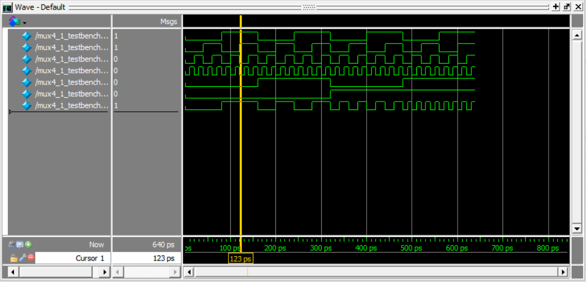
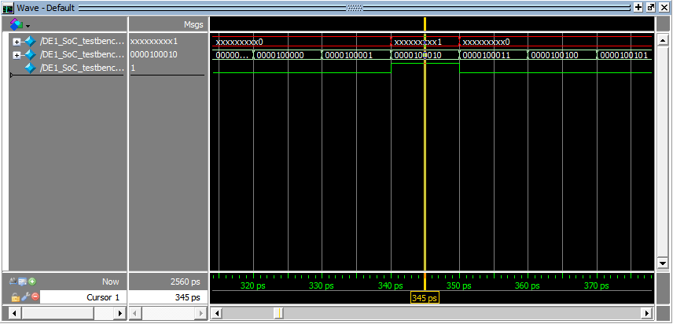
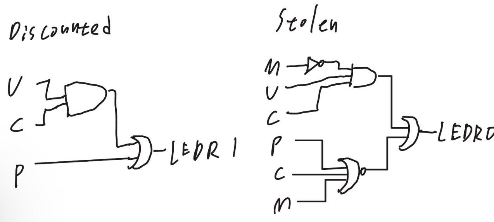
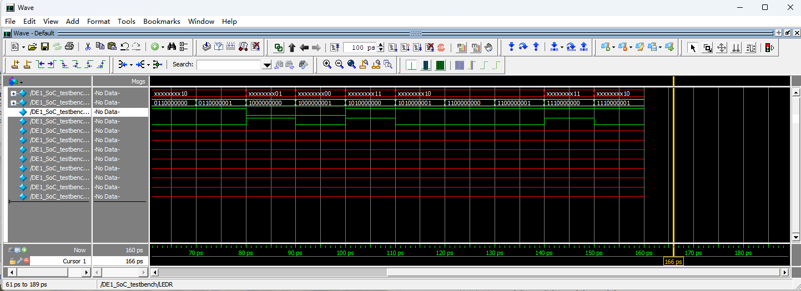
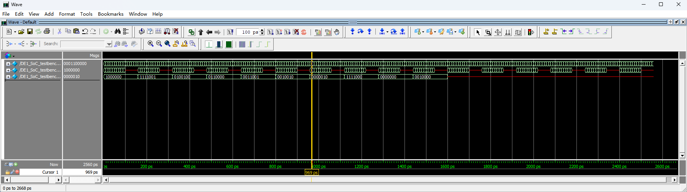
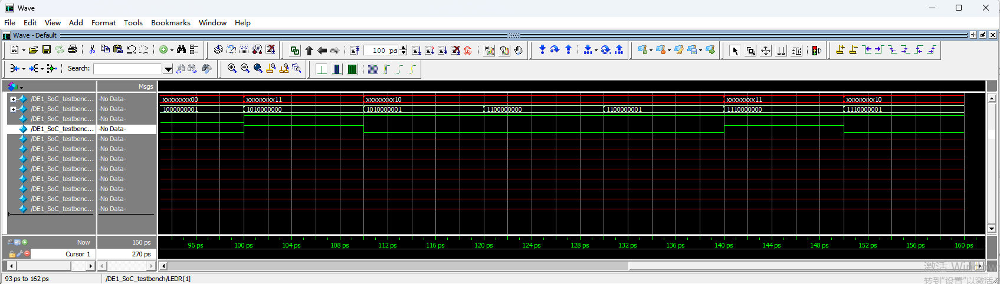
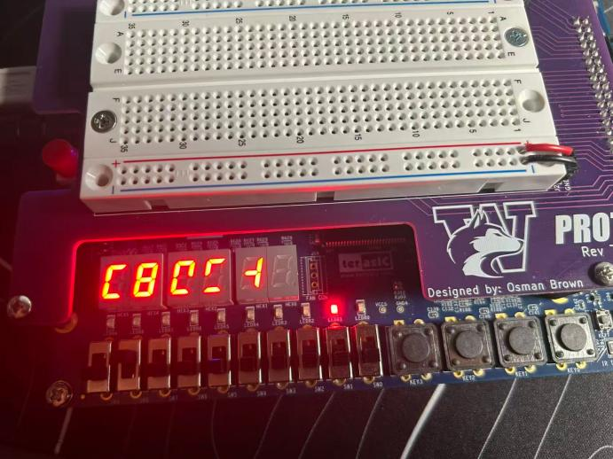
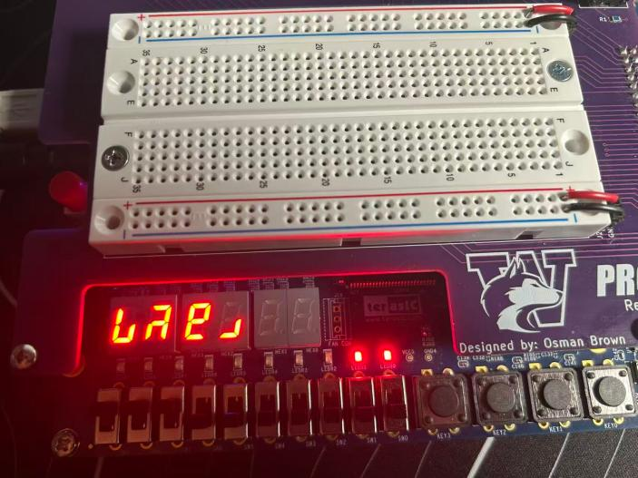

# Digital Logic on FPGA — SystemVerilog Combinational & RTL Design


Five FPGA designs taken end to end on a Terasic DE1-SoC (Intel Cyclone V): RTL source →
testbench → ModelSim simulation → Quartus synthesis → bitfile → hands-on validation on real
hardware.

**Role:** Sole author — design, simulation, hardware validation and report

---

## Highlights

| | |
|---|---|
| **Complete flow ownership** | Installed and configured Quartus Prime Lite 17.0 + ModelSim-Intel FPGA Starter 10.5b + Cyclone V device support and the USB-Blaster II driver, then carried a design from a blank file to a running circuit on silicon |
| **Hierarchical design** | Built a 4:1 multiplexer from three already-verified 2:1 multiplexers rather than writing new Boolean equations |
| **Hand-optimised combinational logic** | Derived a two-output detector from a truth table and Karnaugh maps down to **6 gates** — the minimum for that function — and validated all 16 input combinations on the board |
| **RTL thinking** | For the display tasks, described *what* the output should look like (`always_comb` + `case`) and let the synthesiser perform the Boolean algebra |
| **Don't-care analysis** | Measured, rather than assumed, how `X` inputs resolve on real hardware, and recorded the patterns the tool actually chose |
| **Tool-chain debugging** | Diagnosed and fixed nine distinct environment problems, including a non-ASCII project path that made Quartus 17.0's UI unusable |

## The five designs

| Design | Description | Verification |
|---|---|---|
| **4:1 multiplexer** | Three 2:1 muxes arranged so that `sel1 sel0` names the selected input | Simulation, 64 combinations |
| **Two-digit recognizer** | Lights `LEDR[0]` only when `SW[7:4]` and `SW[3:0]` both equal a chosen digit pair | Board + simulation, 256 combinations |
| **UPC return detector** | Flags discounted items and detects an expensive item returned without its secret mark | Board, all 16 combinations; 6-gate schematic |
| **Two seven-segment displays** | Decodes `SW[3:0]` and `SW[7:4]` to BCD digits on `HEX0` / `HEX1`, with active-low correction | Board, 32 switch settings per digit |
| **UPC code → product display** | Names the product across six displays while the two status LEDs keep working | Board + simulation, all 16 combinations |

## Results gallery

| Figure | Content |
|---|---|
|  | **Fig 1** — `mux4_1` waveform, all 64 input combinations |
|  | **Fig 2** — Two-digit recognizer, 256 combinations, `LEDR[0]` high exactly once |
|  | **Fig 3** — Gate-level schematic of the UPC detector (6 gates) |
|  | **Fig 4** — UPC detector waveform, all 16 combinations of `U, P, C, M` |
|  | **Fig 5** — Seven-segment display waveform (`HEX1` / `HEX0`) |
|  | **Fig 6** — Integrated design: product display plus Discounted and Stolen LEDs |
|  | **Fig 7a** — Board output for the unused code `010` (don't care) |
|  | **Fig 7b** — Board output for the unused code `111` (don't care) |

## Technical deep dive

The interesting engineering is in [`docs/DESIGN_NOTES.md`](docs/DESIGN_NOTES.md):

- truth table and K-map minimisation for the two-output detector, with the reasoning for why
  **6 gates is minimal**;
- the active-low seven-segment encoding, including the bit order and the character set used to
  spell product names on a 7-segment display;
- what don't-care conditions actually resolve to once the design is on silicon.

Environment problems and their root causes are documented in
[`docs/TROUBLESHOOTING.md`](docs/TROUBLESHOOTING.md).

## Repository map

```
.
├── README.md
├── .gitignore
├── docs/
│   ├── DESIGN_NOTES.md          # K-map derivation, gate counts, segment encoding
│   ├── TROUBLESHOOTING.md       # 9 environment problems and their root causes
│   ├── design_report.pdf        # full design report
│   └── figures/                 # 8 waveform captures and board photos
├── src/
│   ├── mux4_1/mux4_1.sv
│   ├── digit_recognizer/DE1_SoC.sv
│   ├── upc_detector/DE1_SoC.sv
│   ├── seven_segment/{seg7.sv, DE1_SoC.sv}
│   └── upc_display/{upc_display.sv, DE1_SoC.sv}
└── scripts/
    ├── run_sim.do               # ModelSim compile/simulate script
    └── Launch_ModelSim.bat      # starts ModelSim in the project directory
```

Each `.sv` file contains both the design module and its testbench. The testbench is never
instantiated by the top-level module, so it is not loaded onto the FPGA and does not need to be
stripped before programming.

## Reproducing this

1. **Toolchain** — Quartus Prime Lite 17.0 with *Devices → Cyclone V* and *ModelSim-Intel FPGA
   Starter Edition* selected during installation; install the USB-Blaster II driver when prompted.
2. **Project** — keep every project on an **ASCII-only path**. Quartus 17.0's file dialogs break
   on non-ASCII paths (see [troubleshooting](docs/TROUBLESHOOTING.md), issue 1).
3. **ModelSim launcher** — edit the single path line in `scripts/Launch_ModelSim.bat` to point at
   your `modelsim.exe`, and place it in the project directory.
4. **Per-design loop**:
   ```tcl
   vlog "./<module>.sv"                       # one line per source file
   vsim -voptargs="+acc" -t 1ps -lib work <testbench>
   do <module>_wave.do                        # created on the first run
   run -all
   ```
   The first `do run_sim.do` stops because `<module>_wave.do` does not exist yet — that is
   expected. Drag the signals into the wave window, `run -all`, save the layout with
   **File → Save Format**, then re-run the script.
5. **Board** — `Start Compilation` → `Tools → Programmer` → `Hardware Setup` → `DE-SoC [USB-1]` →
   open the `.cdf` → `Start`. Wait for *Full Compilation was successful* before pressing Start;
   otherwise the previous `.sof` gets downloaded instead of the new one.

## Toolchain versions

| Component | Version |
|---|---|
| Quartus Prime Lite Edition | 17.0.0 Build 595 |
| ModelSim-Intel FPGA Starter Edition | 10.5b |
| Target device | Cyclone V 5CSEMA5F31C6 |
| Board | Terasic DE1-SoC |
| HDL | SystemVerilog (`.sv`) |

---

## Author

**Aaron (Tianle) Shi** — electrical engineering (RF / hardware focus).

Interested in RF, hardware and semiconductor engineering roles. Feel free to open an issue or
reach out if you would like to discuss the design decisions in this project.
